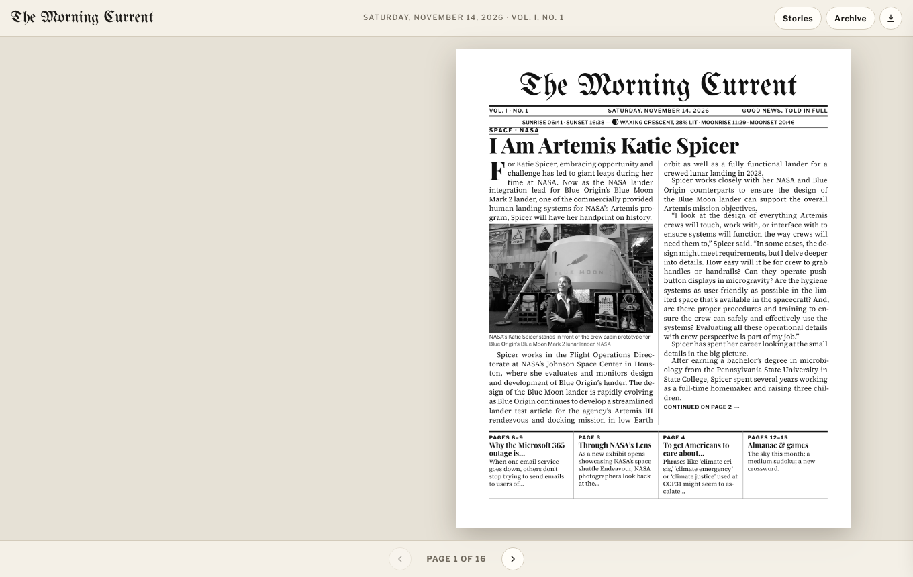
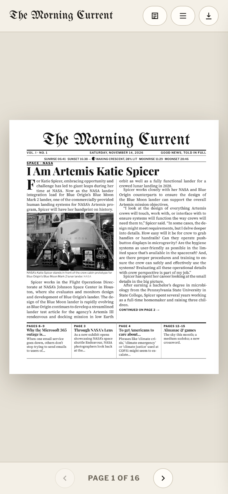
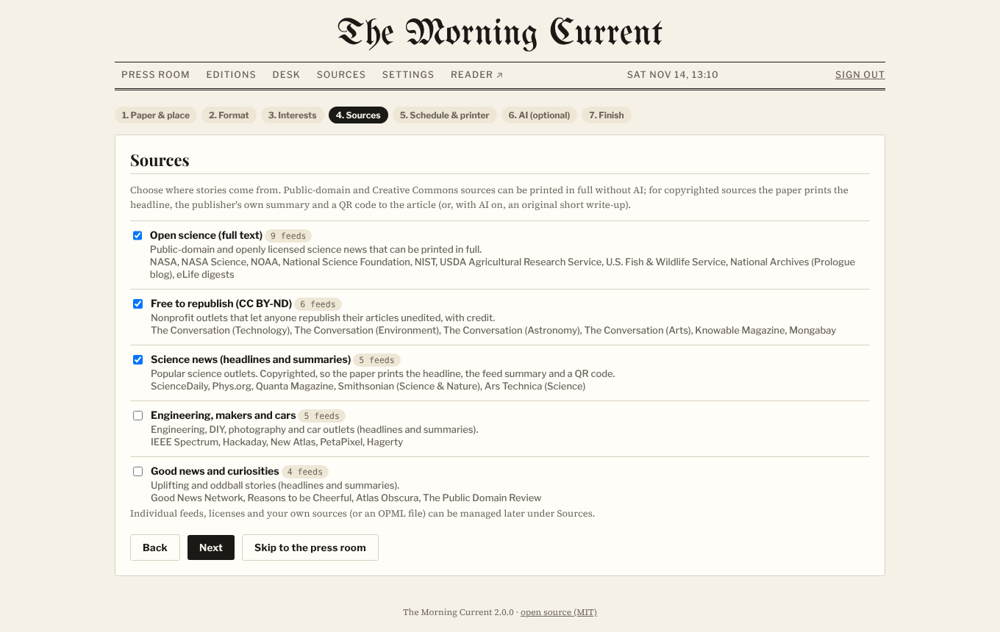
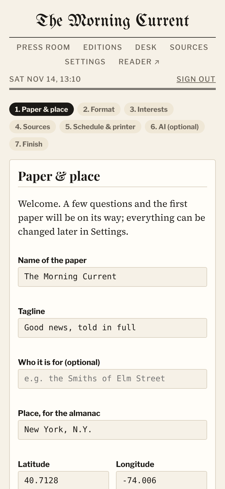
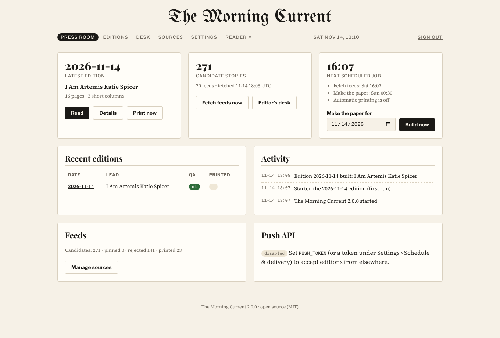
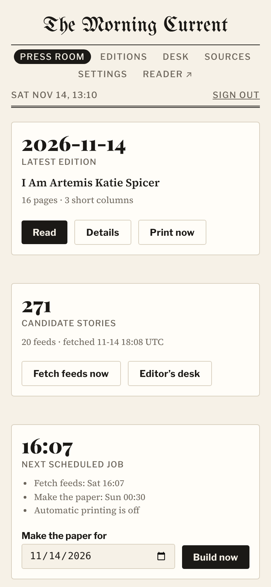
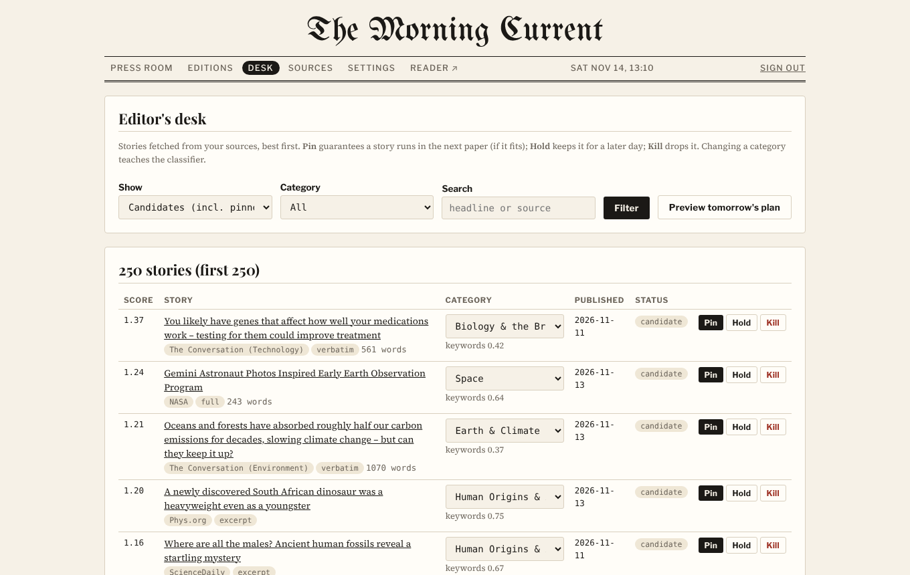
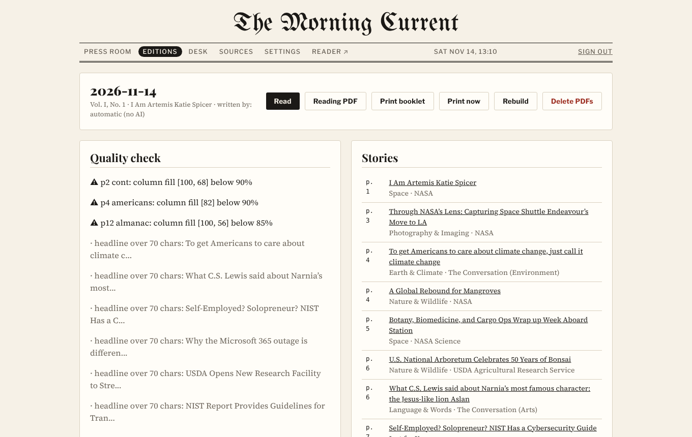

<p align="center"></p>

<h1 align="center">The Morning Current</h1>

<p align="center"><b>A printed morning newspaper for one household, made every night from the feeds you choose.</b><br>
Stories, an almanac for your town and a page of fresh puzzles, laid out as a fold-in-half booklet and printed before breakfast.<br>
Runs entirely without AI; add an API key and Claude writes and researches the stories.</p>

<p align="center">


</p>

## What you get every morning

- **Stories, told in full.** Articles from public-domain and Creative Commons sources (NASA, NOAA, NSF, NIST, USDA,
  The Conversation, Knowable, Mongabay, eLife...) printed whole or trimmed to fit, with photos where the license allows.
  Copyrighted sources appear as their own headline and summary with a QR code to the article.
- **A real newspaper layout.** Front page with lead story and index, features and split pages, a two-page Deep Dive on the
  centre spread, Small Wonders briefs, and a back page with every source, answers and notes. Pages are typeset with
  [Typst](https://typst.app) (justified, hyphenated, real drop caps); the fitter measures every column and trims sentence
  by sentence until each page is full and nothing overflows.
- **An almanac for your place.** Sunrise, sunset, moonrise and phases, a week of daylight, the night sky this month
  and what to look for tonight, all computed locally.
- **Puzzles made fresh each night.** A crossword (clues from WordNet and from the day's stories), sudoku graded by
  weekday, a cryptogram from a quote, a headline scramble, a word ladder, teasers, and optional logic puzzles (KenKen,
  futoshiki, word search, nonogram, kakuro). Yesterday's answers print on the back page.
- **Printing and delivery.** Prints through CUPS on a weekday/weekend schedule (with a vacation hold), or email it,
  copy it to a folder, push it to another server, or just read it in the browser's page-turning reader.

Every check that a person would make happens in code: QR codes are decoded from the rendered PDF, the crossword and
sudoku are verified unique, columns are measured, and a paper with an overflowing page or a broken QR code never ships.

## Quick start

```bash
docker run -d --name morning-current -p 8080:8080 \
  -v ./morning-current:/data \
  -e ADMIN_PASSWORD=choose-one \
  ghcr.io/au12/morning-current:latest
```

Open `http://<host>:8080`, sign in, and follow the setup wizard: name the paper, set your town (for the almanac),
pick a paper size, your favourite subjects and source packs, the schedule and printer, and optionally an API key. It
ends by making your first paper, which takes two or three minutes.

<p align="center">


</p>

**Docker Compose:** see [docker-compose.yml](docker-compose.yml). **Unraid:** add the template
[unraid/morning-current.xml](unraid/morning-current.xml) (Docker > Add Container > Template URL:
`https://raw.githubusercontent.com/au12/MorningCurrent/main/unraid/morning-current.xml`).

| Variable | |
| --- | --- |
| `ADMIN_PASSWORD` | Sign-in for the press room. If unset, one is generated and printed in the container log. |
| `PUID`, `PGID` | Owner of the data folder (default 1000:1000; Unraid uses 99:100). |
| `ANTHROPIC_API_KEY` | Optional: Claude writing and research (or enter it in Settings > AI). |
| `CUPS_SERVER` | Optional: `host:631` of the print server (or set it in Settings). |
| `PUSH_TOKEN` | Optional: enables the [API](docs/api.md) for pushing editions or triggering builds. |
| `COOKIE_SECURE` | `true` when the app is only reached over https. |
| `PORT` | Port inside the container (default 8080). |

Everything else is set in the web UI and stored in `/data/config.yaml`.

## The press room

<p align="center">


</p>

- **Press room:** the latest paper, build now (with a live log), fetch feeds, next scheduled jobs, activity.
- **Editions:** every paper with its QA report, contact sheets, build log, PDFs, print and delete.
- **Desk:** the scored candidates. Pin a story to guarantee it runs, hold it for later, kill it, or correct its
  category (the classifier learns from you). Preview tomorrow's line-up before it is made.
- **Sources:** source packs, every feed with its license, category, trust and per-paper cap, feed tests, OPML import/export.
- **Settings:** paper and place; layout and puzzles (paper size, page count, sections, page shapes, sudoku by weekday,
  logic puzzles, your own cryptogram quotes); content filters (favourites, categories and keywords, blocklist, tone
  threshold, recency); schedule, printer and delivery; AI. A raw `config.yaml` editor covers anything else.
- **Reader** (`/read`): every edition in a page-turning viewer that works on phones, with a list of the day's stories
  and (optionally) thumbs up/down that steer future papers. Public by default; turn that off in Settings.

<p align="center">
</p>

## How a paper is made without AI

1. **Fetch** every feed (conditional GETs, robots.txt respected, polite per-host pacing) into a local SQLite database.
2. **Screen** each article: too old, already printed, a duplicate of another source's story (SimHash and headline
   overlap), on the blocklist (crime, politics, disasters, celebrity, crypto...) or too negative in tone (VADER).
3. **Classify** into your categories by keywords, refined by a small naive Bayes model trained on your own papers and
   corrections (optionally local embeddings).
4. **Score** by freshness, source trust, how much the license lets the paper print, your favourites, your votes and
   variety against recent papers.
5. **Plan** the pages: a Deep Dive long enough for the centre spread, a lead, features and split pages with neighbouring
   categories that differ, Small Wonders and reserve briefs the fitter can use to close short columns.
6. **Write** each story within its license (below), add a verified pull quote and photo when allowed, and make the
   puzzles, word of the day and almanac.
7. **Lay out and fit** with Typst (a whole paper compiles in well under a second), trimming whole sentences until every column is full; then make the
   reading PDF and the imposed booklet, decode every QR code, render contact sheets and run QA.
8. **Publish**: record the paper in the ledger (so stories never repeat), mark its articles used, deliver, and print
   at the scheduled time.

### Licenses decide what is printed

| Source license | Without AI | With AI |
| --- | --- | --- |
| Public domain, CC BY, CC BY-SA | Full text, trimmed to fit, credited | Rewritten to the house style from the source |
| CC BY-ND | Unedited text, cut only at a paragraph end, headline as published, with an excerpt note | Unchanged (no derivatives) |
| Copyrighted | Headline, the publisher's own feed summary, QR code to the article | An original short article written from the source, every quote and number verified |

The bundled source packs were checked in November 2026; read [docs/sources-and-licensing.md](docs/sources-and-licensing.md)
before adding your own.

## Optional: Claude

In Settings > AI choose **Claude** and paste an API key (or set `ANTHROPIC_API_KEY`). Two modes:

- **Rewrite:** the code still picks and fetches tonight's stories; Claude writes each one to the house style from the
  fetched text, sharpens crossword clues and teasers.
- **Research:** Claude also searches the web for candidates that fit your categories, favourites and reader profile;
  the code fetches and screens each page like any feed item.

Every quote must appear word for word in the source and every number must match it; what fails is revised once and
then cut. A per-paper budget (default $1.50) caps spending, and when it runs out the paper carries on without AI.
Any OpenAI-compatible endpoint (Ollama, LM Studio, vLLM, OpenAI) works too. See [docs/ai.md](docs/ai.md).

## Paper sizes

Legal booklet (the original: 8.5 x 14 in sheets folded to 7 x 8.5 in pages), Letter booklet, A4 booklet, Tabloid
booklet, and flat Letter or A4 pages. Booklets need a duplex printer (short-edge flip). Pages are a multiple of four,
up to 32; the planner drops to the light page count on thin news days.

## Running from source

Python 3.11+ on Linux or macOS:

```bash
git clone https://github.com/au12/MorningCurrent && cd MorningCurrent
pip install -e .                     # or: pip install -r requirements.txt
python3 -m mc.words download         # WordNet and the CMU pronouncing dictionary for the puzzles
MC_DATA=./data python3 -m mc serve   # http://localhost:8080
```

The same work is available from the command line (`python3 -m mc help`):

```bash
python3 -m mc ingest                 # fetch feeds
python3 -m mc candidates             # scored candidates and the planned line-up
python3 -m mc make 2026-11-16        # the whole nightly job for one date
python3 -m mc build 2026-11-16       # re-lay out an existing edition
python3 -m mc sources test <url>     # try a feed
```

Tests: `pip install pytest && pytest` (the two end-to-end tests make whole papers and take under a minute;
`pytest -m "not slow"` skips them).

## Project layout

```
mc/                 the application (python -m mc)
  ingest/           feeds, extraction, dedup, tone, classifier, scoring, article database
  auto/             planner and license-aware automatic writer
  ai/               Claude / OpenAI-compatible writing, research and verification
  puzzles/          sudoku, crossword, word puzzles, logic puzzles, daily puzzle inputs
  web/              FastAPI app: press room, settings, reader, scheduler, push API
  paper.typ         the paper's styles and page parts (Typst)
  build.py, edition.py, templates.py, components.py, style.py, measure.py
                    layout, fitting, PDFs, booklet imposition, QR checks, QA
  almanac.py, words.py, config.py, profiles.py, rules.py, delivery.py, pipeline.py
docs/               configuration, sources and licensing, AI, API, migration, layout reference
tests/              pytest suite
```

The project grew out of one household's paper, written nightly by a scheduled Claude Code routine; its hand-written
edition format still builds here (see [docs/layout.md](docs/layout.md)).

## License

MIT for the code and data in this repository; bundled fonts and browser libraries keep their own licenses (see
[THIRD_PARTY_NOTICES.md](THIRD_PARTY_NOTICES.md)). Printed articles belong to their publishers: the app prints only
what each source's license allows, and you are responsible for the sources you add.
